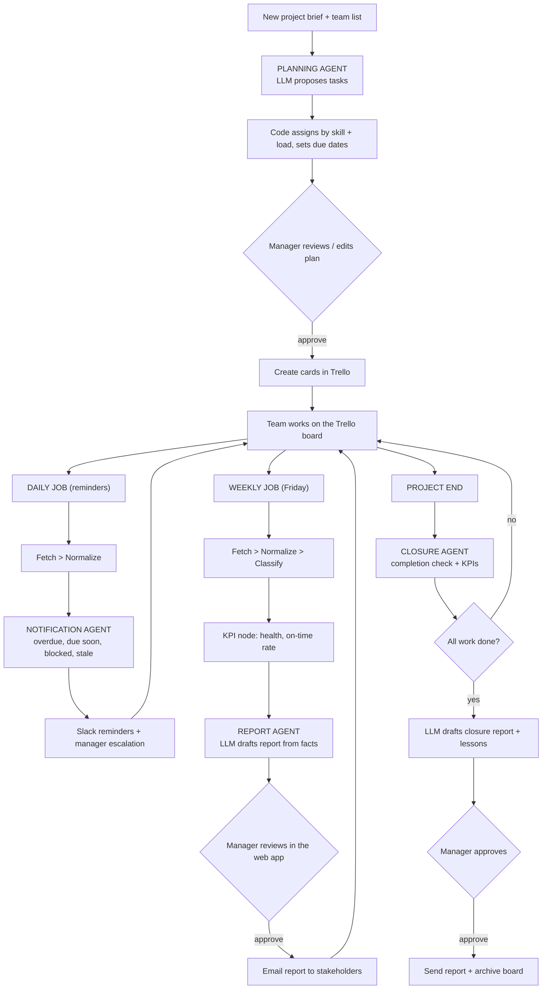

# End-to-End Workflow

## Where an LLM is used (and where it is not)
| Step | LLM? | Why |
|---|---|---|
| Fetch, normalize, classify, KPI | No | Counting and rules must be exact and testable |
| Task assignment and due dates | No | Deterministic: skill match, least-loaded person |
| Notification building | No | Rules on due dates and activity |
| Task breakdown from a brief | Yes | Needs language understanding |
| Weekly report wording | Yes | Turns structured facts into readable prose |
| Closure report and lessons | Yes | Same, from structured facts |

## Models
Gemini is the only LLM provider (`GOOGLE_API_KEY`). The model defaults to `gemini-3.8-flash`; override with `LLM_MODEL` in `.env`. One model is used for all agents. With no key, template drafts are used.

## Tools and libraries
Python 3.11, LangGraph (workflow), langchain-google-genai (Gemini access), Flask (JSON API) + React/Vite (web UI),
requests (Trello and Slack HTTP), python-dotenv, APScheduler (in-process scheduling), GitHub Actions (optional hosted scheduling),
Trello REST API, SMTP (email), Slack incoming webhook.

## API keys and settings
| Setting | Needed for | Where to get it | Required? |
|---|---|---|---|
| TRELLO_API_KEY, TRELLO_TOKEN | Reading/writing the board | trello.com/power-ups/admin | Yes (real data) |
| TRELLO_BOARD_ID | Which board | Board URL + `.json`, copy top-level `id` (not secret) | Yes (real data) |
| GOOGLE_API_KEY | LLM (Gemini) | aistudio.google.com | Optional; none = templates |
| SMTP_HOST/PORT/USER/PASSWORD, REPORT_FROM, REPORT_TO | Emailing reports | Your mail provider (use an app password) | Optional (else saved to data/reports) |
| SLACK_WEBHOOK_URL | Reminders | Slack app > Incoming Webhooks | Optional (else saved to data/reports) |
| GitHub repo secrets | Hosted schedule | Repo Settings > Secrets | Only for GitHub Actions |

Never commit `.env` (a `.gitignore` is included). Trello write access is only used when Dry run is off.

## Web app (frontend)
A React (Vite) single-page app served by the Flask JSON API (`npm run build` in `frontend/`). Same pattern for every module:
`GET /page`, `GET /api/<module>` (JSON), `POST /api/refresh/<module>`.

| Page | Route | What it answers |
|---|---|---|
| Dashboard | `/dashboard` | Project completion %, tasks done / in progress / blocked / overdue, pipeline Backlog > Development > Testing > Done, planned vs actual dates |
| Weekly Report | `/weekly-report` | KPIs, risk radar (stuck, blocked, overdue, moved back), reminders, editable report draft |
| Planning | `/planning` | Brief + team to tasks, assignments and due dates, then create Trello cards |
| Closure | `/closure` | Completion check, closure report, archive board |

The board is fetched once into `data/cache/cache_board.json` (refreshed every 30 minutes in the background, or with the Refresh button),
and every page reads that cached data, so opening a page never calls Trello.
Health checks: `/ping` and `/api/trello-health`. Security headers are set on every response.

## Trello label conventions (free plan friendly)
| Meaning | Label or title | Example |
|---|---|---|
| Project | `Project: <name>` | `Project: Project 1` |
| Release | `Release: <name>` | `Release: v1.4` |
| Team | `Team: <name>` | `Team: Backend` |
| Phase | `Phase: <name>` | `Phase: QA` |
| Blocked | label `Blocked` (+ a comment with the reason) | `Blocked` |
| Status | the list the card is in | To Do / Doing / In Review / Done |

Names are configurable in `backend/src/pmo/config.py` (including the order phases appear in). Cards without a Release or Phase label appear as "Unassigned" / "No phase" on the dashboard.
